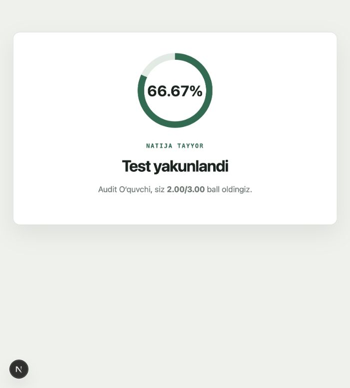

# Testify: milliy sertifikat mockiga tayyorlik

Tekshiruv sanasi: 2026-10-09. Mahalliy ishchi kod, mavjud saqlanmagan o‘zgarishlar bilan tekshirildi.

**Xulosa:** oddiy bitta variant tanlanadigan test oqimi ishlaydi. Rasmiy milliy sertifikat namunalarini to‘liq import qilish, topshirish va baholash hozir ishlamaydi. To‘liq milliy sertifikat mocki sifatida markazga taklif qilishga hali tayyor emas.

## Tekshirilgan foydalanuvchi oqimi

Ustoz PDF yuklaydi → draftni tekshiradi → e’lon qiladi → o‘quvchi havoladan mock topshiradi → ustoz natijalarni ko‘radi.

Rasmiy milliy sertifikat uchun birinchi uzilish PDF importida aniqlandi. Shu namunalarning keyingi bosqichlari ishlaydi deb xulosa qilinmadi. Oddiy testning qolgan oqimi alohida demo bilan tekshirildi.

| Bosqich | Dalil | Holat |
|---|---|---|
| Ustoz kabinetiga kirish | Brauzer orqali demo hisobga kirish, API login 200 | Ishlaydi |
| Oddiy mockni ochish/boshlash | Public quiz 200, start 201 | Ishlaydi |
| Savollar va taymer | Uch savolli testda javob berish, refreshdan so‘ng javoblar va taymer tiklanishi | Ishlaydi |
| Javoblarni topshirish | Submit 201; 2 to‘g‘ri, 1 xato: 2/3 ball, 66,67% | Ishlaydi |
| Ustoz natijalari | Results 200; reyting va savollar kesimidagi 100%, 100%, 0% natijalar | Ishlaydi |
| Brauzer konsoli | Tekshirilgan oqimda error/warn yozuvlari yo‘q | Toza |
| Milliy sertifikat PDF importi | Quyidagi uch rasmiy 45 topshiriqli variantda 400 | Ishlamaydi |

## Rasmiy namunalarda qayta ishlab ko‘rish

Manbalar UZBMBning [namunalar sahifasidan](https://uzbmb.uz/page/namuna_m) olindi. Bu bitta ochiq namunaga asoslangan tekshiruv; barcha ustozlarning PDFlarini qamrab olmaydi.

| Fan | So‘ralgan topshiriq | Parser topgan yozuv | API natijasi | Manba |
|---|---:|---:|---|---|
| Tarix | 45 | 33 | 400: faqat 33 ta yaroqli savol topildi | [Mahalliy PDF](sources/history-sample.pdf), [rasmiy PDF](https://uzbmb.uz/upload/file/pdf/mtt/namuna/Tarix-namuna.pdf) |
| Matematika | 45 | 33 | 400: faqat 33 ta yaroqli savol topildi | [Mahalliy PDF](sources/math-sample.pdf), [rasmiy PDF](https://uzbmb.uz/upload/file/pdf/milliytest/matem.pdf) |
| Ona tili va adabiyot | 45 | 32 | 400: faqat 32 ta yaroqli savol topildi | [Mahalliy PDF](sources/uzbek-sample.pdf), [rasmiy PDF](https://uzbmb.uz/upload/file/pdf/milliytest/ona_tili.pdf) |

**Bu sonlar to‘g‘ri import qilingan savollar soni emas.** Masalan, tarix namunasida parserning to‘rtinchi yozuvi asl 4-savol o‘rniga ichki ro‘yxatdagi `6. Braziliyada monarxiya quladi.` bo‘lib qolgan. Matematika va tarixdagi umumiy variantlar berilgan 33–35-topshiriqlar ham to‘liq saqlanmagan. Savollar sonini 20 ga tushirish bu yo‘qotishlarni tuzatmaydi.

## Eng muhim muammolar

1. **[P1] Sinov savollarini saqlash avvalgi javoblarni o‘chiradi.** `backend/apps/quizzes/serializers.py:322` barcha eski savollarni o‘chiradi. `AttemptAnswer.question` esa CASCADE. Test bazasida topshirilgan mockni o‘zgartirmasdan qayta saqlash 200 qaytardi, ammo javob yozuvlari 3 tadan 0 taga tushdi; attemptning 2,00 balli saqlanib qoldi. Natija bilan savol analitikasi bir-biriga mos kelmay qoladi. Tajriba tranzaksiya ichida qaytarildi. Faol yoki topshirilgan testni bloklash yoki savollar versiyalarini saqlash kerak.

2. **[P1] Ochiq javob va esse uchun ma’lumot modeli/oqimi yo‘q.** `QuestionSerializer` kamida ikki variantni talab qiladi; o‘quvchi faqat `choice_id` yuboradi. Qisqa javobli savolni `choices: []` bilan qo‘shish 400 va `Kamida 2 ta variant kerak.` qaytardi. Milliy sertifikatdagi a/b qismlar, qisman ball va ona tili essesi uchun alohida javob saqlash hamda ustoz baholashi kerak.

3. **[P1] PDF parser tuzilmani yo‘qotadi.** Ichki raqamlangan ro‘yxatlar savol boshiga aylanadi, umumiy shart/variantlar va ustun tartibi buzilishi mumkin. Varianti yo‘q savollar `len(question.choices) >= 2` shartida tashlab yuboriladi. Savol raqami, umumiy shart va kichik bandlar saqlanishi kerak; yo‘qolgan topshiriqlar import tekshiruvida ochiq ko‘rsatilishi kerak.

4. **[P1] Rasm, chizma va matematik ifodalar ishonchli saqlanmaydi.** Hozir import faqat `page.extract_text()`ga tayanadi. Savol/variantlarda rasm maydoni va frontendda matematik render yo‘q. Rasmiy matematika namunasining 41-savolida diagramma va a/b javoblar bor. Savolni asl PDF sahifasi yoki crop bilan ko‘rsatish, keyin tuzilgan matematik matnni qo‘llash mumkin.

5. **[P2] Milliy sertifikatga mos baholash/shablon yo‘q.** Faqat `standard` va `dtm_189` mavjud. Import barcha savollarga 1 ball beradi, manbadagi 1,1/1,3/2,2/3,2 kabi ballarni olmagan. Ustoz ballni qo‘lda o‘zgartira oladi, lekin avtomatik import baholashi mos emas. Hozirgi oddiy yoki DTM foizini rasmiy milliy sertifikat natijasi deb taqdim qilib bo‘lmaydi. Milliy sertifikat baholash modeli va fan shablonlari alohida kerak.

## O‘tgan tekshiruvlar

- Django testlari: 11/11 o‘tdi.
- `manage.py check`: muammo yo‘q.
- `makemigrations --check --dry-run`: yangi migratsiya talab qilinmadi.
- Frontend `npm run lint`: o‘tdi.
- Frontend `npm run build`: o‘tdi, TypeScript tekshiruvi ham muvaffaqiyatli.
- Mavjud testlar oddiy PDF parser, mock extraction bilan import soni, javob kaliti, DTM 90/189, reyting, qog‘oz javoblar va ayrim bir urinish cheklovlarini tekshiradi. Ularning o‘tishi milliy sertifikatni tasdiqlamaydi.

## Pilotdan oldin ustuvor ketma-ketlik

1. Topshirilgan test natijalari qayta saqlashda buzilishini to‘xtatish.
2. Bitta fan uchun to‘liq model: qisqa javob, a/b bandlar, umumiy shart/variantlar va ustozning javob kaliti.
3. PDFning asl ko‘rinishini saqlab, savollar va kalitni ustoz tekshiradigan import oqimi.
4. Fan va variantga mos ball/vaqt shabloni; mos bo‘lmagan natijani rasmiy sertifikat balli deb atamaslik.
5. Tanlangan markaz ustozining haqiqiy variantida 45 topshiriqni boshidan oxirigacha sinash.

## Dalillar va chegaralar

- [Import va ochiq javob API natijalari](api-probes.json)
- [Savollarni qayta saqlash tajribasi](save-quiz-probe.json)
- [Oddiy mockning brauzerdagi natijasi](basic-mock-result.jpg)
- Alohida vaqtinchalik SQLite baza va mahalliy backend/frontend ishlatildi. Mavjud loyiha bazasidagi yozuvlar tekshiruvda o‘zgartirilmadi.
- 100–200 parallel foydalanuvchi, production server va AI orqali test yaratish tekshirilmadi. Ushbu hisobot ularga tayyorlikni tasdiqlamaydi.

